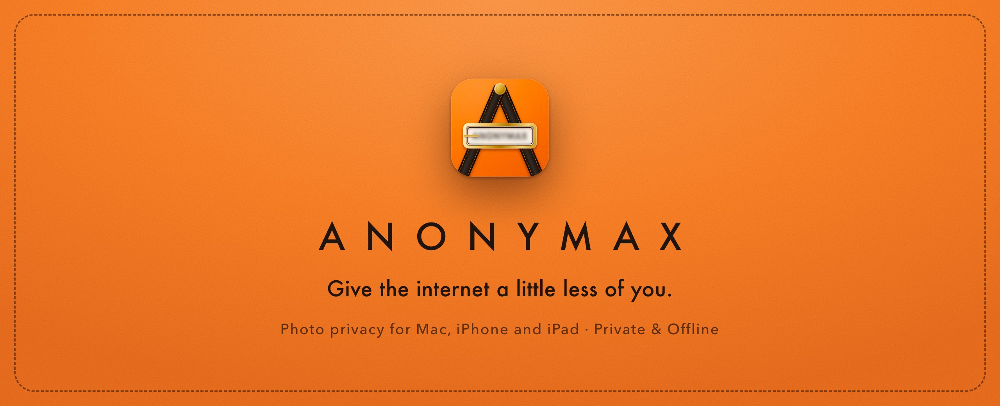
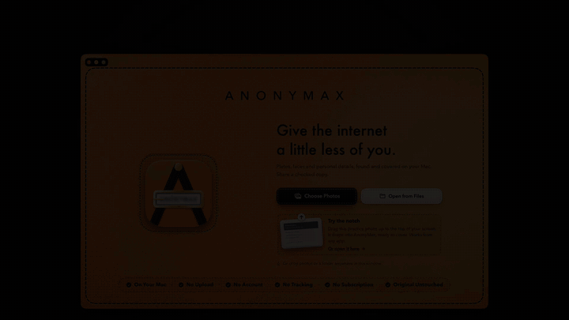
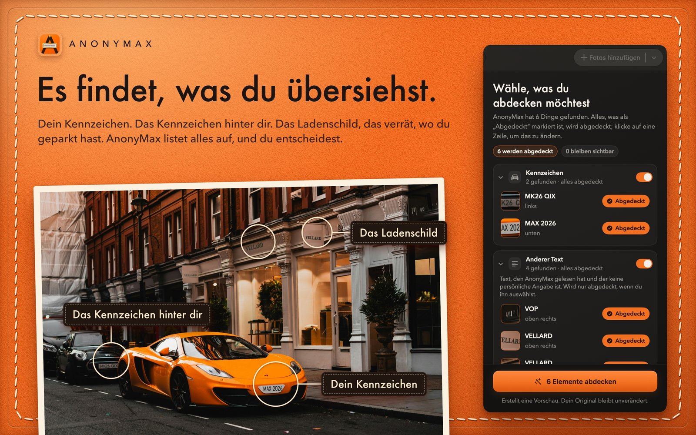
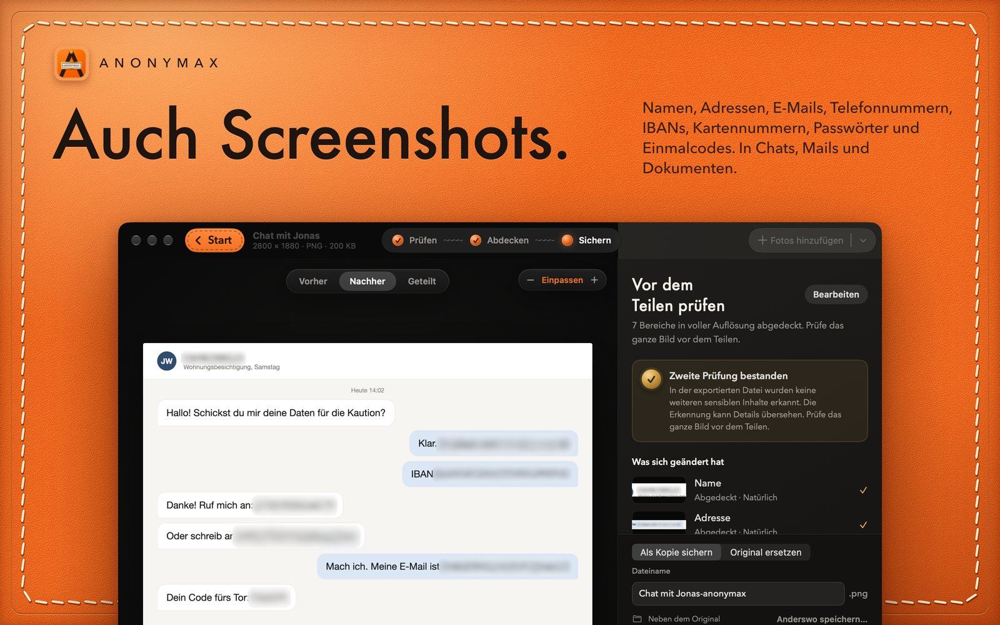
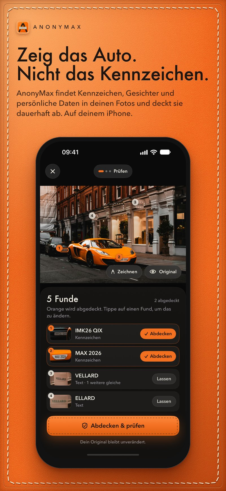
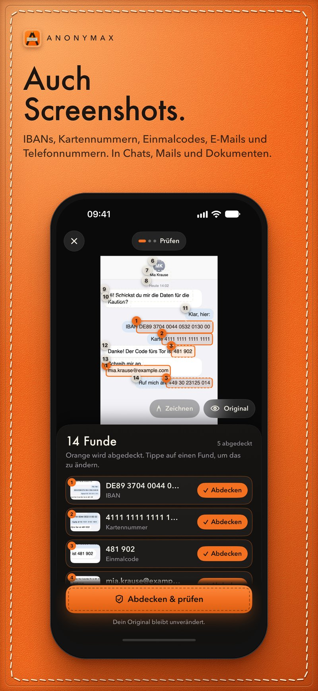
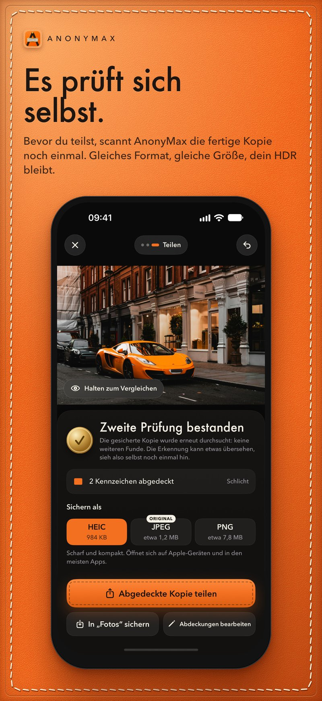
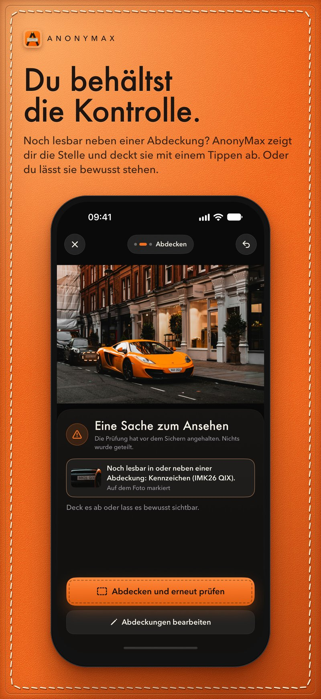
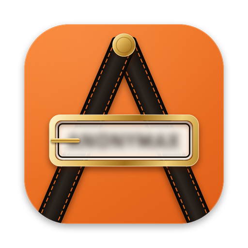

<a href="https://anonymax.app/de/">
  <picture>
    <source media="(prefers-color-scheme: dark)" srcset="docs/hero-dark.jpg">
    
  </picture>
</a>

<h1 align="center">AnonyMax: Fotos anonymisieren auf Mac, iPhone und iPad</h1>

<b>Gesichter verpixeln, Kennzeichen unkenntlich machen, Standort entfernen: bevor du teilst.</b>

**AnonyMax ist eine App für Mac, iPhone und iPad, die Fotos, Bildschirmfotos und Scans anonymisiert. Sie findet Gesichter, Kennzeichen und persönliche Angaben und deckt sie ab, entfernt verborgene Daten wie den Standort und prüft die Kopie, bevor du sie teilst. Privat & offline, auf deinem Gerät.**

  
  
  
  
  
  

<!-- Am Launch-Tag: das „bald verfügbar“-Badge durch Apples offizielle deutsche Badges ersetzen, unverändert, App Store zuerst. -->

  <a href="https://anonymax.app/de/"><b>anonymax.app/de</b></a> ·
  <a href="https://anonymax.app/de/so-funktionierts/">So funktioniert’s</a> ·
  <a href="https://anonymax.app/de/free-und-pro/">Free und Pro</a> ·
  <a href="#fragen">Fragen</a> ·
  <a href="https://github.com/onekapisch/anonymax-photo-privacy/issues/new/choose">Problem melden</a> ·
  <a href="README.md">English</a>

> [!NOTE]
> Dieses Repository ist die Schaufenster-, Doku- und Feedback-Seite von AnonyMax, nicht der Quellcode. AnonyMax kommt bald in den App Store, für Mac, iPhone und iPad.

<table>
  <tr>
    <td width="50%"></td>
    <td width="50%"></td>
  </tr>
  <tr>
    <td align="center"><b>Vorher.</b> Du wolltest das Auto zeigen. Ein fremdes Kennzeichen kam mit.</td>
    <td align="center"><b>Nachher.</b> Abgedeckt, zweite Prüfung bestanden, bereit zum Teilen.</td>
  </tr>
</table>

Foto: Jack Lucas Smith auf <a href="https://unsplash.com/photos/orange-sports-car-parked-on-a-city-street-c6MugCfh-aw">Unsplash</a>. Abdeckungen von AnonyMax.

## Wofür du es brauchst

- **Kennzeichen unkenntlich machen** für den Autoverkauf auf mobile.de, Kleinanzeigen oder AutoScout24, auch das Kennzeichen des Autos dahinter.
- **Gesichter verpixeln, aber richtig:** Kinderfotos posten, ohne dass Gesichter erkennbar sind. Auf dem Mac deckt Pro auf Wunsch nur die Kinder ab („Nur Kinder abdecken“) oder setzt Sticker auf Gesichter.
- **Bildschirmfoto schwärzen:** Namen, Adressen, E-Mails, Telefonnummern, IBANs, Kartennummern und Codes in Chats und Scans.
- **EXIF-Daten und Standort aus dem Foto entfernen:** Ort, Gerät und Besitzerangaben, Bildunterschriften und Stichwörter verschwinden aus der gesicherten Kopie.

## Weichzeichnen ist keine Abdeckung

Unscharfer oder verpixelter Text lässt sich oft zurückrechnen: Ein Programm, das die Schrift kennt, probiert Text aus, macht ihn genauso unscharf und vergleicht. Forschende haben das öffentlich gezeigt ([Depix](https://github.com/spipm/Depix), [Unredacter](https://github.com/BishopFox/unredacter), [Studie von 2016](https://arxiv.org/abs/1609.00408)).

Wir haben es vor dem Start an unserer eigenen App versucht: Eine unscharf gemachte 16-stellige Kartennummer wurde vollständig zurückgelesen, in 2 von 2 Versuchen, in jeweils etwa 45 Sekunden. Deshalb wurde jede Abdeckung neu gebaut, nur aus der Umgebung und frischem Zufall, nie aus dem Geheimnis selbst. Bei allen vier Looks (Schlicht, Natürlich, Mosaik, Farbe) holte derselbe Angriff **0 von 3** Geheimnissen zurück, nicht besser als Raten. Er läuft heute bei jedem Build als Leak-Test mit. [Die ganze Geschichte, mit Zahlen](https://anonymax.app/de/so-funktionierts/).

## So sieht es aus

<table>
  <tr>
    <td width="50%"></td>
    <td width="50%"></td>
  </tr>
</table>
<table>
  <tr>
    <td width="25%"></td>
    <td width="25%"></td>
    <td width="25%"></td>
    <td width="25%"></td>
  </tr>
</table>

App-Store-Bildschirmfotos von AnonyMax 1.0 (7) für Mac und 1.0 (15) für iPhone und iPad, aus der echten App. Alle Beispieldaten sind erfunden.

## Free und Pro

**5 Fotos kostenlos. Jedes Foto mit Pro.** Free: 5 Fotos im Monat mit der Abdeckung Schlicht, eins nach dem anderen. Finden, verborgene Daten entfernen und die zweite Prüfung sind immer kostenlos. Pro: jedes Foto, dazu Natürlich, Mosaik und Farbe; auf dem Mac außerdem Hauptperson sichtbar lassen, Nur Kinder abdecken, Sticker, ganze Serien, Notch, Finder und Kurzbefehle. Ein Kauf, kein Abo, für Mac, iPhone und iPad. Den aktuellen Preis findest du auf [anonymax.app/de/free-und-pro](https://anonymax.app/de/free-und-pro/).

## Privat & offline

Finden, Abdecken, Bereinigen und Prüfen passieren auf deinem Gerät. AnonyMax funktioniert ohne Internet und ohne Konto. Die Mac-App läuft in der Sandbox und hat keine Netzwerk-Berechtigung. Dein Original bleibt, wie es ist; gesichert wird eine abgedeckte Kopie.

## Fragen

<b>Wie mache ich ein Kennzeichen unkenntlich, bevor ich mein Auto verkaufe?</b>

Öffne das Foto in AnonyMax. Es findet die Kennzeichen, auch das des Autos dahinter, und listet sie auf. Lass sie auf „Abdecken“, wähle einen Look und sichere die Kopie. Standort und Gerätedaten sind darin schon entfernt. Ein einfacher Weichzeichner reicht für Kennzeichen nicht: Unscharfe Kennzeichen wurden schon per Software zurückgelesen.

<b>Lädt AnonyMax meine Fotos hoch?</b>

Nein. Deine Fotos werden auf deinem Gerät verarbeitet. Es gibt kein Konto und keinen eigenen Server, und die Mac-App hat gar keine Netzwerk-Berechtigung.

<b>Funktioniert es mit Bildschirmfotos, Scans und PDFs?</b>

Bildschirmfotos und Scans als Bilddatei: ja. PDF-Dateien noch nicht.

<b>Findet AnonyMax alles?</b>

Es findet das meiste, was ein Fremder lesen könnte, und zeigt dir jeden Fund, bevor gesichert wird. Die zweite Prüfung scannt die fertige Kopie noch einmal, und du kannst jederzeit von Hand abdecken. Hat es etwas übersehen? Beschreib es im Formular [Etwas übersehen](https://github.com/onekapisch/anonymax-photo-privacy/issues/new?template=missed_detection.yml), in Worten, nie mit dem echten Foto.

<b>Welche Geräte und Sprachen?</b>

Mac ab macOS 14 Sonoma, iPhone und iPad ab iOS und iPadOS 17. Deutsch und Englisch.

## Warum ich AnonyMax gebaut habe

> Jeden Tag teilen Menschen Fotos, die mehr zeigen, als sie wollten: ein Kennzeichen in einer Autoanzeige, das Gesicht eines Kindes, ein Name auf einem Paket, eine Wohnadresse in einem Bildschirmfoto, der genaue Ort, gespeichert in der Datei. Es geht nicht nur um Autoverkäufer, sondern auch um Creator, Familien und Eltern. Ich wollte eine einfache Möglichkeit, das abzufangen, bevor du auf „Teilen“ tippst.
>
> **Kapisch**, Macher von AnonyMax · [Die ganze Geschichte](https://anonymax.app/de/geschichte/)

---

   
  <b>AnonyMax</b> · Gib dem Internet ein bisschen weniger von dir. 
  Gemacht in Deutschland von Kapisch · <a href="https://www.onekapisch.com/">OneKapisch</a> · Presse: <a href="https://anonymax.app/de/presse/">Pressemappe</a> und support@onekapisch.com

