<a href="https://anonymax.app/">
  <picture>
    <source media="(prefers-color-scheme: dark)" srcset="docs/hero-dark.jpg">
    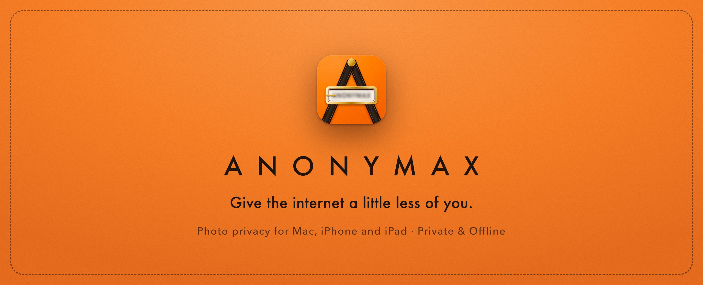
  </picture>
</a>

<h1 align="center">AnonyMax: Photo Privacy for Mac, iPhone and iPad</h1>

<b>Hide faces, number plates and personal text before you share.</b> Blur a license plate, hide a face, redact a screenshot and remove the location from a photo, in one step, on your device.

**AnonyMax is a photo privacy app for Mac, iPhone and iPad. It finds and covers faces, number plates and personal text in photos, screenshots and scans, removes hidden data like the location, and checks the copy before you share it. Private & Offline, on your device.**

  
  
  
  
  
  
  
  

<!-- Launch day: replace the "coming soon" badge above with Apple's official badges, unmodified, App Store first:

-->

  <a href="https://anonymax.app/"><b>anonymax.app</b></a> ·
  <a href="https://anonymax.app/how-it-works/">How it works</a> ·
  <a href="#blur-is-not-a-cover">Why blur is not enough</a> ·
  <a href="#compared">Compare</a> ·
  <a href="#free-and-pro">Free &amp; Pro</a> ·
  <a href="#faq">FAQ</a> ·
  <a href="https://github.com/onekapisch/anonymax-photo-privacy/issues/new/choose">Report an issue</a> ·
  <a href="README.de.md">Deutsch</a>

> [!NOTE]
> This repository is the showcase, documentation and feedback home of AnonyMax, not its source code. AnonyMax is coming soon to the App Store for Mac, iPhone and iPad.

<a href="https://anonymax.app/">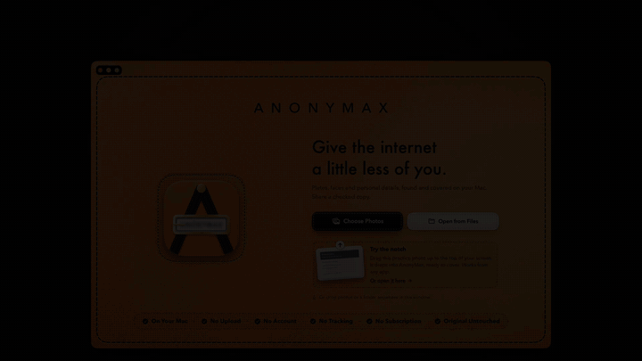</a>

AnonyMax 1.0 (7) on a Mac, recorded from the app. Watch the full film on <a href="https://anonymax.app/">anonymax.app</a>.

<table>
  <tr>
    <td width="50%"></td>
    <td width="50%"></td>
  </tr>
  <tr>
    <td align="center"><b>Before.</b> You came for the car. A stranger's plate came with it.</td>
    <td align="center"><b>After.</b> Covered with the Natural look, re-checked, ready to share.</td>
  </tr>
</table>

Photo: Jack Lucas Smith on <a href="https://unsplash.com/photos/orange-sports-car-parked-on-a-city-street-c6MugCfh-aw">Unsplash</a>. Covers made by AnonyMax.

## Why I built it

> Every day, people share photos that show more than they meant to: a number plate in a car ad, a child's face, a name on a parcel, a home address in a screenshot, the exact location saved inside the file. It isn't just car sellers. It's content creators, families and parents. Most of the time nobody notices until the photo is already online. I wanted a simple way to catch that before you hit share. That's AnonyMax.
>
> **Kapisch**, maker of AnonyMax · [Read the whole story](https://anonymax.app/story/)

## Blur is not a cover

A blur or a pixelation looks safe to a person. It is not safe against a program. Every hidden letter still nudges the blurred pixels in its own way, so software that knows the font can type guesses, blur them the same way and keep the guess that matches.

- Security researchers have read pixelated text back: [Depix](https://github.com/spipm/Depix) recovers text from pixelated screenshots, and Bishop Fox's [Unredacter](https://github.com/BishopFox/unredacter) ([write-up](https://bishopfox.com/blog/unredacter-tool-never-pixelation)) does it for pixelated text in general.
- Researchers showed back in 2016 that recognition models can still identify faces and read digits after blurring and pixelation: [Defeating Image Obfuscation with Deep Learning](https://arxiv.org/abs/1609.00408).

**We tried it on our own app first.** Before launch, a guessing program read a blurred 16-digit card number back in full, in 2 of 2 tries, in about 45 seconds each. A blurred plate was read back in 3 of 3 tries, and pixelated text in 5 of 5. So the old blur and pixelate were removed, and every cover was rebuilt.

**How AnonyMax covers differ.** A cover is built from the pixels around the secret plus fresh randomness, never from the secret itself. Against all four looks that ship today (Plain, Natural blur, Mosaic and Color match), the same attack recovered **0 of 3** secrets: no better than chance. That attack now runs as a leak test in every build. [The full account, with the numbers](https://anonymax.app/how-it-works/).

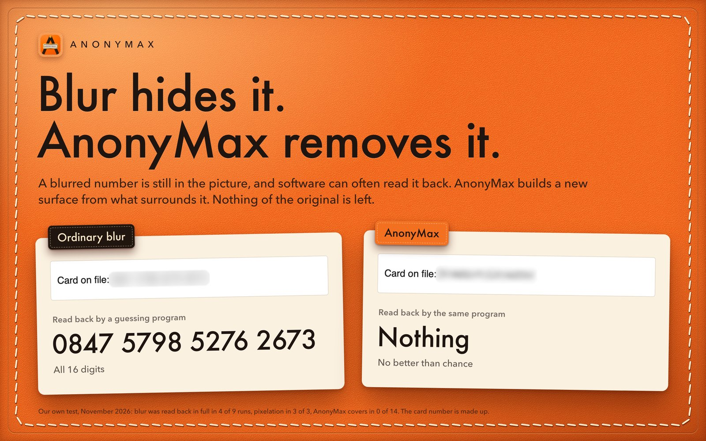

## You hid the plate. What about the rest?

A photo tells two stories: the one you meant to share, and the details you never meant to give away. This is what AnonyMax looks for today.

| What gives you away | AnonyMax 1.0 |
|---|---|
| Faces, including people in the background | Found and covered |
| Number plates, yours and the car behind | Found and covered |
| Personal text: names, addresses, emails, phone numbers, IBANs, card numbers, ID numbers, one-time and booking codes | Found and covered |
| QR codes and barcodes | Found and covered |
| Shop signs, street names and other readable text | Found and listed. You choose what to cover |
| Location, device and owner details, captions and keywords inside the file | Removed from the saved copy |
| Whole people, documents, all text | Optional finders, switch them on in Settings |
| Reflections in windows or glasses, school logos, landmarks | Hard for any tool. Look for them yourself and draw a cover by hand |

AnonyMax finds most of what a stranger could read, and you see every finding before anything is saved. Missed something? Draw a cover with a rectangle, an ellipse or a brush on the Mac, or with your finger on iPhone and iPad.

## What it does

**Drop. Review. Cover. Clean. Check. Share.**

<table>
  <tr>
    <td width="50%">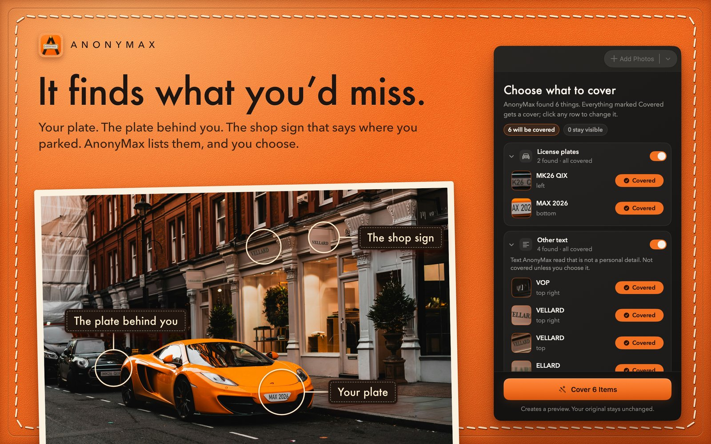</td>
    <td width="50%">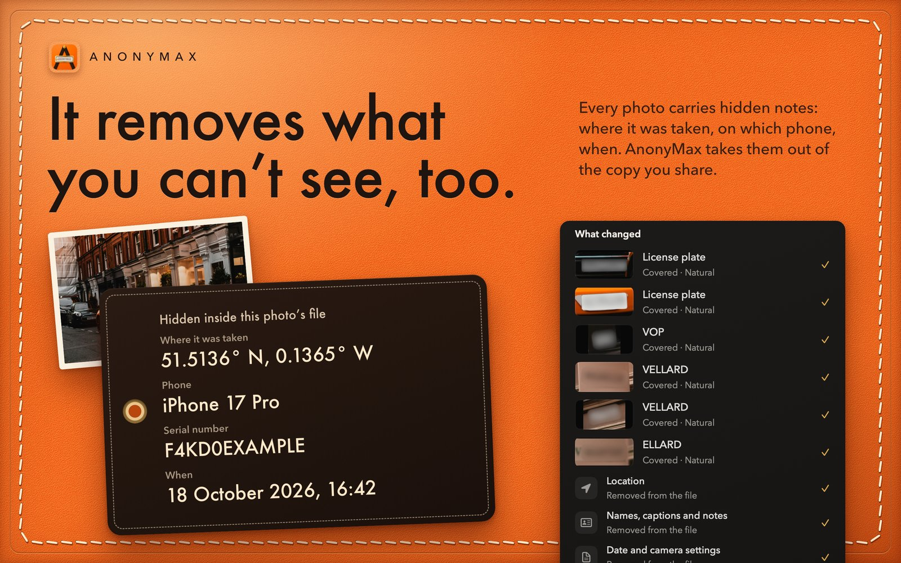</td>
  </tr>
  <tr>
    <td>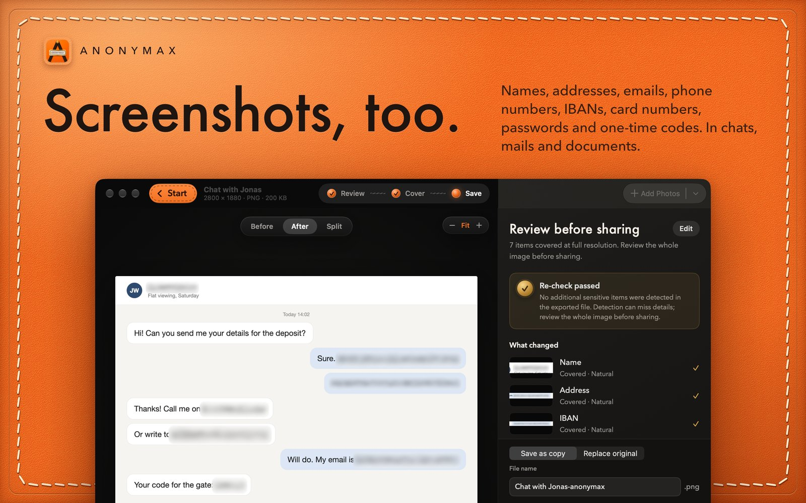</td>
    <td>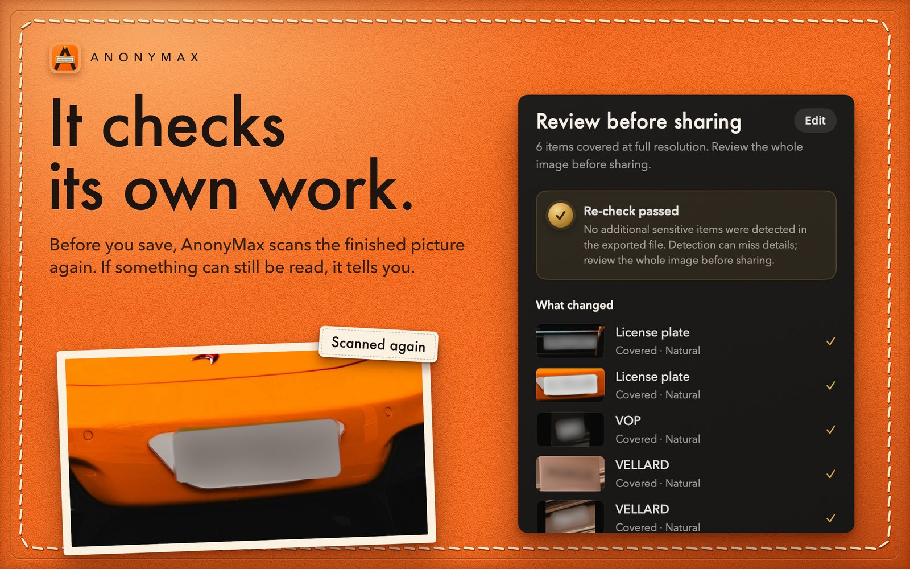</td>
  </tr>
</table>

<table>
  <tr>
    <td width="25%">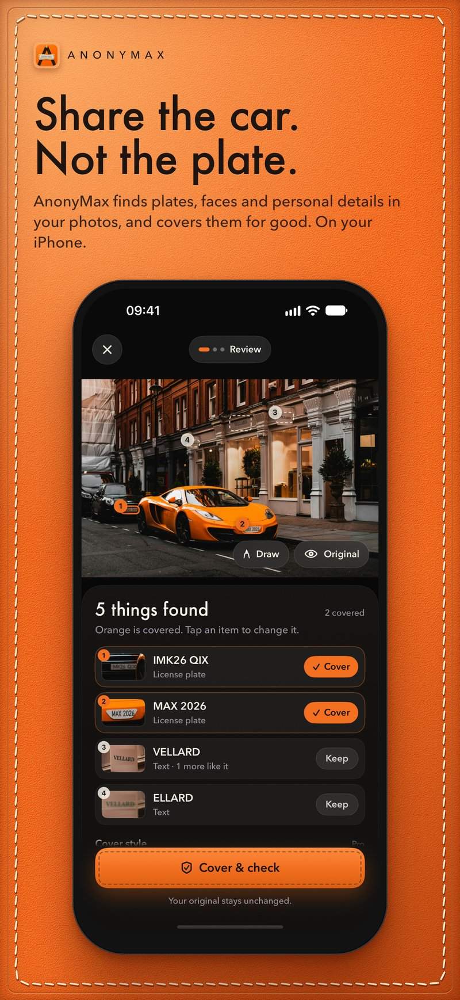</td>
    <td width="25%">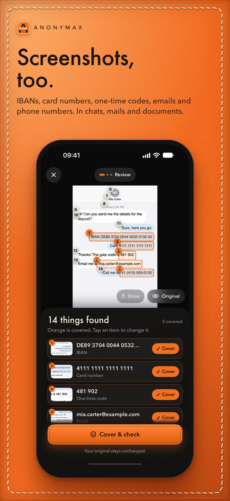</td>
    <td width="25%">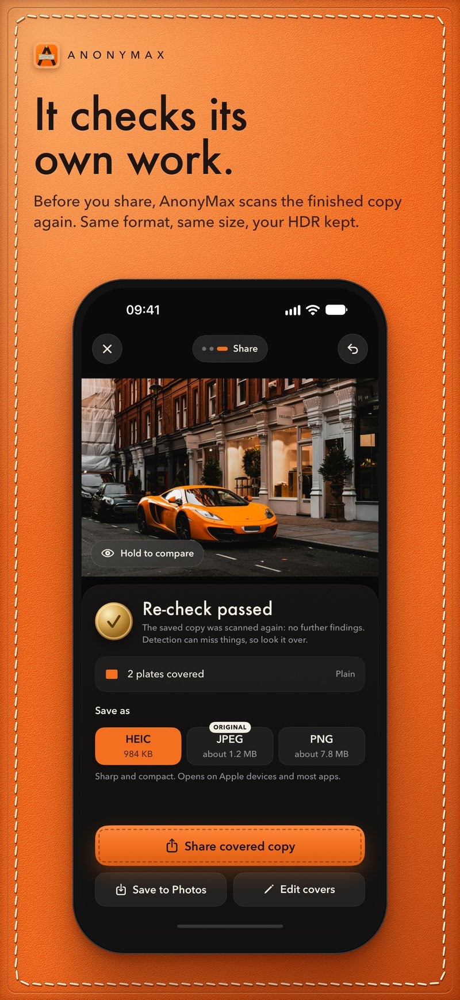</td>
    <td width="25%">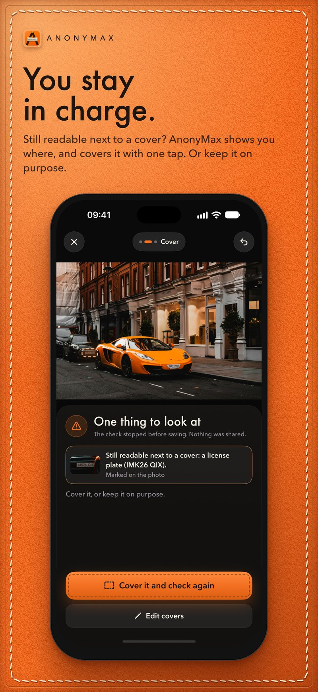</td>
  </tr>
</table>

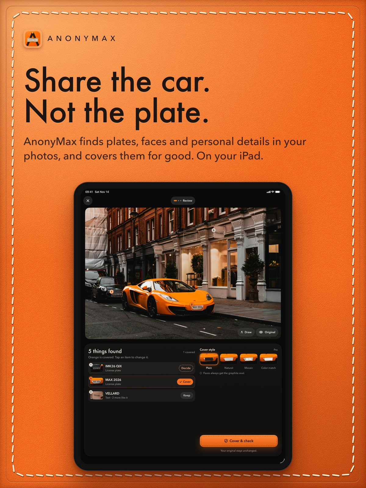

App Store screenshots of AnonyMax 1.0 (7) for Mac and 1.0 (15) for iPhone and iPad, made from the real app. Example content is invented: fictional plates, an invented chat and example addresses.

## How it works

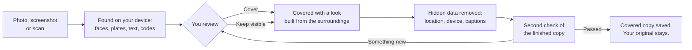

Every step runs on your device. AnonyMax works without an internet connection and without an account.

## Who it's for

<table>
  <tr>
    <td width="50%" valign="top">
      <h3>Selling a car</h3>
      
Blur the license plate before you post on mobile.de, Kleinanzeigen, AutoScout24, eBay or Facebook Marketplace. AnonyMax also finds the plate of the car behind yours, and removes where the photo was taken.

    </td>
    <td width="50%" valign="top">
      <h3>Parents and families</h3>
      
Hide kids' faces before you post a family photo. On the Mac, Pro can cover only the children and leave the adults visible, or put a friendly sticker over a face.

    </td>
  </tr>
  <tr>
    <td valign="top">
      <h3>Content creators</h3>
      
Filming or shooting in public? Cover strangers in the background, the plates on the street and the shop sign that says exactly where you are, without a mask-by-mask edit.

    </td>
    <td valign="top">
      <h3>Screenshots and scans</h3>
      
Redact a chat screenshot, a booking confirmation or a scanned letter before you send it to a landlord, an employer or a support team: names, addresses, IBANs, card numbers and codes.

    </td>
  </tr>
</table>

## Compared

AnonyMax next to apps people use to hide what a photo gives away.

| | **AnonyMax** | Redacted | BlurData | Maskr | Plate Blur AI | CleanShot X |
|---|:-:|:-:|:-:|:-:|:-:|:-:|
| Finds faces | **✓** | ✓ | ○ | ✓ | ○ | ○ |
| Finds license plates | **✓** | ○ | ✓ | ◐ | ✓ | ○ |
| Finds personal details in text | **✓** | ✓ | ✓ | ✓ | ◐ | ○ |
| Finds QR codes and barcodes | **✓** | ○ | ✓ | ✓ | ○ | ○ |
| Removes location and camera data | **✓** | ✓ | ○ | ✓ | ✓ | ○ |
| Checks its own result | **✓** | ○ | ○ | ○ | ○ | ○ |
| Native Mac app | **✓** | ✓ | ✓ | ◐ | ✓ | ✓ |
| Price | **5 photos a month free, Pro [one-time](https://anonymax.app/free-and-pro/)** | $9.99 once for automatic finding | $79 a year or $149 once | Free | Free, Pro $5.99 a month or $39.99 | $35 once |

✓ yes · ◐ partly or limited · ○ not offered or not listed by the maker

Redacted: finding faces and text needs Pro. BlurData: codes are off by default. Maskr: Chinese plate formats only; an iPad app that runs on Apple silicon Macs. Plate Blur AI: faces only when you ask; other readable text and file cleaning need Pro. Facts about other apps come from each maker's own App Store or website page, checked on 11 November 2026, as the maker states them; we did not test them. Prices as listed in the US App Store or on the maker's site. Apps change: if something here is out of date, write to support@onekapisch.com and we will fix it. Names belong to their owners; AnonyMax is not affiliated with them. Where others are ahead: several of them handle video, and BlurData and Redacted work on PDFs. AnonyMax does photos, screenshots and image scans for now.

## Free and Pro

**5 photos free. Every photo with Pro.**

| | Free | Pro |
|---|---|---|
| Photos | 5 a month, one at a time | Every photo |
| Finding faces, plates, text and codes | ✓ | ✓ |
| Hidden data removal and the second check | ✓ | ✓ |
| Covers | Plain | Plain, plus Natural blur, Mosaic and Color match: covers nobody notices |
| On the Mac | | Keep the main subject visible, cover only the children, sticker face covers, whole sets at once, the notch, Finder and Shortcuts |

Pro is one purchase, with no subscription, for Mac, iPhone and iPad with your Apple Account. See the current price on [anonymax.app/free-and-pro](https://anonymax.app/free-and-pro/).

## Privacy by design

- **Private & Offline.** Finding, covering, cleaning and checking are processed on your device. AnonyMax works without an internet connection.
- **No network access on the Mac.** The Mac app is sandboxed and has no network permission.
- **No account, no ads.** No sign-up, no third-party analytics or advertising code.
- **Your original stays.** AnonyMax saves a covered copy. The original is unchanged unless you choose to replace it.

Read the [privacy policy](https://anonymax.app/privacy/) and [SECURITY.md](SECURITY.md).

## FAQ

<b>How do I blur a license plate before selling my car?</b>

Open the photo in AnonyMax. It finds the number plates, including the one on the car behind yours, and lists them. Keep them marked Cover, choose a look and save. The saved copy also has the location and device details removed. Avoid a plain blur for plates: blurred plates have been read back by software.

<b>How do I hide a face in a photo on iPhone or Mac?</b>

AnonyMax finds the faces in a photo and covers them, on Mac, iPhone and iPad. You can keep any face visible with one tap, or draw a cover by hand over anything it missed.

<b>Is blurring or pixelating a face or text safe?</b>

Not reliably. Pixelated text has been read back by tools like Depix and Unredacter, and research has shown that blurred and pixelated faces can still be recognised by software. AnonyMax covers are built without the hidden pixels, and a read-back attack runs against them in every build. See [Blur is not a cover](#blur-is-not-a-cover).

<b>How do I remove the location from a photo?</b>

AnonyMax removes the location, the device and owner details, captions and keywords from the copy it saves. On the Mac you can choose to keep the date and camera settings. On iPhone, Apple's share sheet also has an option to leave out the location for a single share.

<b>Does AnonyMax upload my photos?</b>

No. Your photos are processed on your device. AnonyMax has no account and no server of its own, and the Mac app has no network permission at all.

<b>Does it work offline?</b>

Yes. Turn off Wi-Fi and it works the same.

<b>Can I hide only my children's faces?</b>

Yes, on the Mac with Pro: "Cover only the children" covers children and teens and can leave adults visible. You can also use sticker face covers. On iPhone and iPad, version 1.0 covers faces and you choose which ones stay visible.

<b>Does it work on screenshots, scans and PDFs?</b>

Screenshots and scanned documents saved as images, yes: JPEG, HEIC, PNG, TIFF and more on the Mac, and JPEG, HEIC, PNG and TIFF on iPhone and iPad. PDF files are not supported yet.

<b>What is free and what is Pro?</b>

Free covers 5 photos a month with the Plain cover, one at a time. Finding, hidden data removal and the second check are always free. Pro covers every photo and adds the Natural blur, Mosaic and Color match looks, plus the Mac's extras. See [Free and Pro](#free-and-pro).

<b>Which Macs, iPhones and iPads are supported?</b>

Macs with macOS 14 Sonoma or later, and iPhones and iPads with iOS or iPadOS 17 or later.

<b>Does AnonyMax change my original photo?</b>

No. It saves a covered copy. On the Mac you can choose to replace the original instead.

<b>Will it find everything?</b>

It finds most of what a stranger could read, and it shows you every finding before you save. The second check scans the finished copy again, and you can always draw a cover by hand. If it missed something, tell us with the [missed detection form](https://github.com/onekapisch/anonymax-photo-privacy/issues/new?template=missed_detection.yml), described in words, never with the real photo.

<b>Which languages does it support?</b>

English and German.

## Requirements

| | |
|---|---|
| Mac | macOS 14 Sonoma or later |
| iPhone and iPad | iOS and iPadOS 17 or later |
| Languages | English, German |
| Account | None |
| Internet | Not needed |

## Feedback

- **Something missed?** Use [It missed something](https://github.com/onekapisch/anonymax-photo-privacy/issues/new?template=missed_detection.yml). Describe it in words. Never attach real photos of people or plates.
- **A problem?** [Report a problem](https://github.com/onekapisch/anonymax-photo-privacy/issues/new?template=bug_report.yml).
- **An idea?** [Suggest an idea](https://github.com/onekapisch/anonymax-photo-privacy/issues/new?template=feature_request.yml).
- **Security or anything private:** support@onekapisch.com. See [SECURITY.md](SECURITY.md).

## More from OneKapisch

[Handlefree](https://handlefree.app/) · [SkyLocation](https://www.skylocation.app) · [LUMEL](https://getlumel.app) · [Clip 4 Breakfast](https://www.clip4breakfast.app) · [All apps at onekapisch.com](https://www.onekapisch.com/)

---

  <a href="https://anonymax.app/">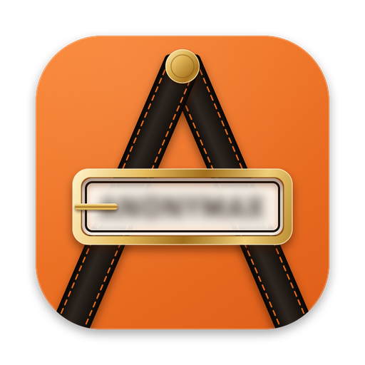</a> 
  <b>AnonyMax</b> · Give the internet a little less of you. 
  Made in Germany by Kapisch · <a href="https://www.onekapisch.com/">OneKapisch</a> · Press: <a href="https://anonymax.app/press/">press kit</a> and support@onekapisch.com

